<h1 align="center">VitaXMB</h1>

<p align="center">
  <b>A PSP-style XMB launcher for the PlayStation Vita.</b><br>
  The cross media bar, rebuilt for the Vita: your games and homebrew, music, settings and system apps in the layout, motion and sound of the original.
</p>

<p align="center">
  
</p>

<p align="center">
  
  
  
</p>

---

## Contents

- [Features](#features)
- [Screenshots](#screenshots)
- [Controls](#controls)
- [Installing](#installing)
- [Starting VitaXMB when the Vita turns on](#starting-vitaxmb-when-the-vita-turns-on)
- [Building from source](#building-from-source)
- [How it works](#how-it-works)
- [PSP games](#psp-games)
- [Languages](#languages)
- [Game artwork](#game-artwork)
- [Music and video](#music-and-video) (video player beta)
- [Columns, folders and moving apps](#columns-folders-and-moving-apps)
- [Trophies](#trophies)
- [Updates](#updates)
- [Custom themes (beta)](#custom-themes-beta)
- [Extra storage (experimental)](#extra-storage-experimental)
- [Settings reference](#settings-reference)
- [Repository layout](#repository-layout)
- [Changelog](#changelog)
- [Known issues](#known-issues)
- [Credits and licenses](#credits-and-licenses)

## Features

**The XMB, faithfully**

- Six categories on a horizontal bar (Settings, Photo, Music, Video, Game, Network) with the PSP's icon sizes, spacing, glow, drop shadows, rules under selected titles and its monthly color themes with the animated waves.
- **Sharp icons.** Every XMB icon is drawn at twice the PSP's size (128 px), keeping the PSP's glassy shading, so none of them look blurry on the Vita's screen.
- The two-level layout the PSP uses for Settings: the open category slides left, the parent list collapses into an icon column, and the child list shows wrench-badge rows with values on the right.
- A wide-icon **game list**: the selected title grows into a landscape tile while neighbours stack above and below. Rest on a game and its full-screen background art fades in behind the list.
- The PSP's real **wave background** (the firmware's own wave model, animated the way the PSP animates it) and its **boot intro** (logo, ribbon and glow with the month's tint) before the XMB appears.
- Startup animation (fade in, bar and lists slide in together), the XMB sound set (opening, cursor, cancel, confirm, start game), PSP-style confirmation dialogs and the **Options** panel opened with the triangle button.
- Text is rendered the way the PSP does it: a soft drop shadow, kerned, sub-pixel positioned and glued to its icon while scrolling.

**Made for the Vita**

- **Game** lists every installed title and homebrew bubble (and your saved data), reads each app's own LiveArea artwork, and starts it. *Information* shows title, ID, version and location.
- **Last played:** the game you started last sits under Memory Stick with the PSP's UMD icon, like the disc in a PSP's drive. Move the cursor onto it and the disc gives way to the game's own landscape picture (and, for a PSP game, its video and sound), the way the PSP's XMB does it. Select it to start the game again.
- **All your PSP and PS1 games, with or without a bubble.** Every ISO / CSO in `ux0:pspemu/ISO` and every `EBOOT.PBP` in `ux0:pspemu/PSP/GAME` is listed in *Game* under its real name, with its ICON0 and PIC1 artwork, whether or not Adrenaline made a LiveArea bubble for it. Resting on one plays its **ICON1.PMF video and SND0.AT3 sound**, like the PSP's XMB (see [PSP games](#psp-games)).
- **The PSP's own languages.** *Settings > System Settings > System Language* switches VitaXMB between the 12 languages of the PSP (Japanese, English, French, Spanish, German, Italian, Dutch, Portuguese, Russian, Korean, Traditional and Simplified Chinese), or follows the Vita's language (*Automatic*). The texts come from the PSP firmware's own language tables; only VitaXMB's own settings are translated by hand. Game, save, music and video titles are never translated (see [Languages](#languages)).
- **Game boot movie.** Starting a game plays the PSP's own game boot movie, with the start-game jingle and a logo laid over it, and then starts the game. The logo is **PSV / PlayStation Vita** by default; *Game Boot Logo* in *Settings > VitaXMB Settings* switches it to the PSP's own picture (**PSP / PlayStation Portable**).
- **The PS button stays out of the way inside VitaXMB:** it no longer drops to the LiveArea, like the PSP's XMB (a long press still opens the Vita's quick menu). Leave VitaXMB with *Exit to LiveArea* in Settings.
- **Touch screen** support for the whole XMB (see [Controls](#controls)).
- **NoLiveArea plugin (beta):** an optional plugin, offered at the first start, that keeps the LiveArea out of sight: VitaXMB opens by itself when the Vita turns on, the screen stays black while a game loads, and VitaXMB comes back when a game closes (see [NoLiveArea plugin](#nolivearea-plugin-beta)).
- **Columns of your own:** rename, reorder, hide and add columns and folders, and sort your apps into them (see [Columns, folders and moving apps](#columns-folders-and-moving-apps), which has a short tutorial). Custom themes and your own columns do not mix: see the warning there.
- **Hide categories** you don't use (Photo, Music, Video, Network, Emulators, Utilities) in *Settings > VitaXMB Settings*; the bar closes up and left/right skip them.
- **Your apps where they belong.** ViTube can sit under Video, Moonlight under Network, RetroArch under Emulators: every app can be moved to any column (Photo, Music, Video, Game, Network, and the new **Emulators** and **Utilities**, which show up once something is in them), and every column can hold your own folders. A "Move to..." screen moves one app, **Organize Apps** moves many at once, and the first start offers to sort what is installed for you (see [Columns, folders and moving apps](#columns-folders-and-moving-apps)).
- **Trophies** without opening the LiveArea: *Game > Trophy Collection* lists every game with its progress, and a game's Options has *Trophies* (see [Trophies](#trophies)).
- **Settings** has real, working pages: *System Information* (firmware, nickname, MAC address, model, memory card, battery, CPU clock), plus VitaXMB's own settings (theme color, clock format, sound effects, startup animation, confirmation dialogs, launch method).
- **Music** plays **MP3, FLAC, WAV, AIFF and Ogg Vorbis** with the PSP's player screen: LED spectrum analyzer driven by the real audio, track badge, title and artist from the file's tags, elapsed and total time, progress bar, next/previous and seeking. Files are streamed from the card, so a big lossless file does not need the memory it takes. The list uses the PSP's own number box, digits and format tag, redrawn at the Vita's native resolution.
- **Video player (beta)** plays videos inside VitaXMB with the PSP video player's control panel and a much wider choice of formats than the PSP had: MP4, MOV, M4V and 3GP (H.264) with the Vita's hardware decoder, and MKV, AVI, WebM, WMV, FLV, TS, MPEG and more in software. See [Music and video](#music-and-video).
- **Network and Photo** hand off to the Vita's own apps (Internet Browser, PlayStation Store, Party, Messages, Near, Photos), and Settings opens the Vita's real settings pages.

**Updates and themes**

- **Network Update** is the first item under Settings, like the PSP's System Update: it checks GitHub for a new release, shows the release notes and installs it for you (see [Updates](#updates)).
- **PSP custom themes (beta)**: drop `.ctf` / `.ptf` theme files in a folder and apply them from *Settings > Theme Settings* (see [Custom themes (beta)](#custom-themes-beta)).

**Engineering**

- Smooth scrolling on a very large game library: icons and backgrounds are decoded on worker threads and uploaded a couple per frame; GPU textures are only freed once the GPU has finished with them.
- Own text engine: FreeType glyphs with light auto-hinting in a padded atlas, HarfBuzz shaping (OpenType kerning), a pre-blurred shadow per glyph.
- A baseline-normalised font so every letter, at every UI size, lands on the same pixel row (see [Fonts](#fonts)).

## Screenshots

| | |
|---|---|
| 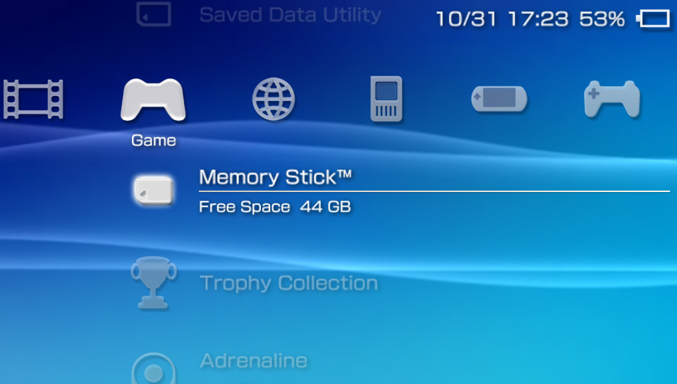 <br> **Game** - installed titles and saved data | 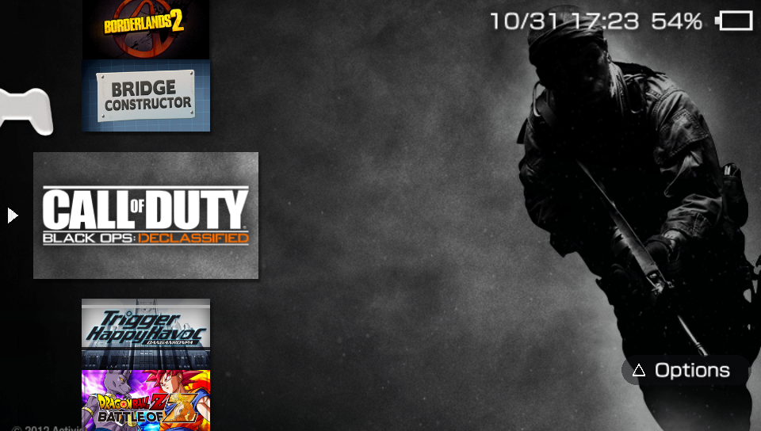 <br> **Game list** - wide tiles, background art on rest |
| 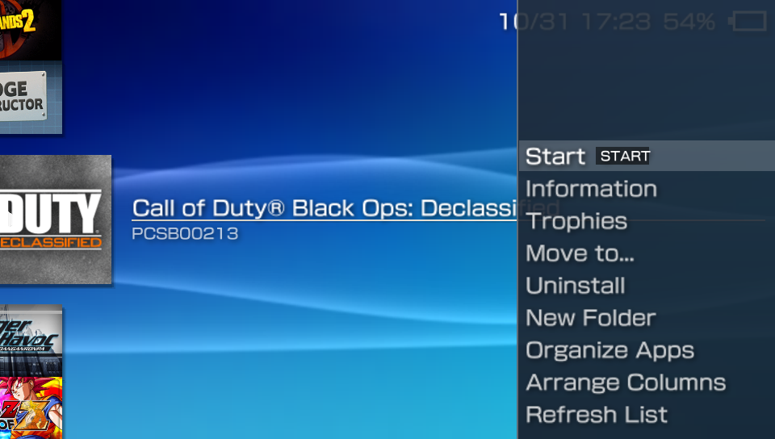 <br> **Options** (triangle) - Start, Information, Refresh | 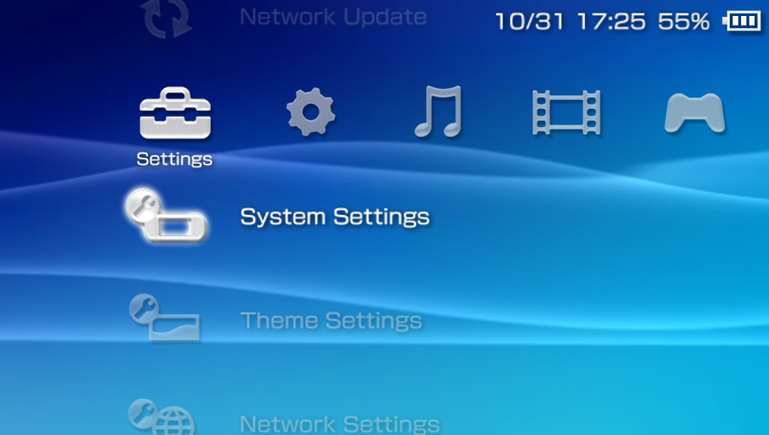 <br> **Settings** - the PSP's settings groups |
| 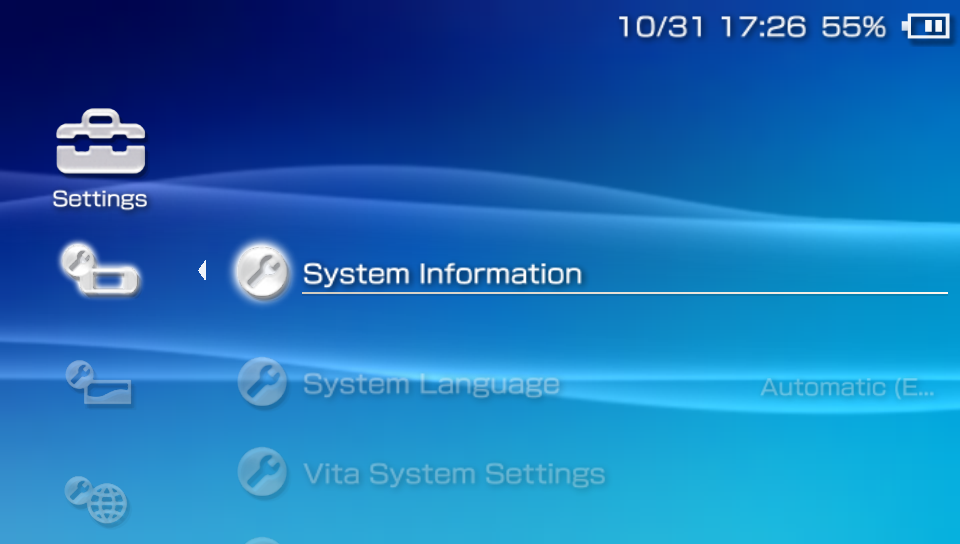 <br> **Two-level Settings layout** | 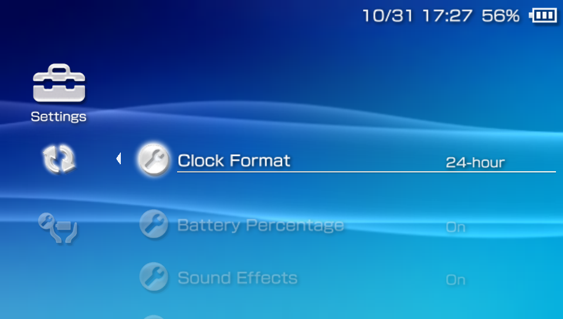 <br> **VitaXMB Settings** - values on the right |
| 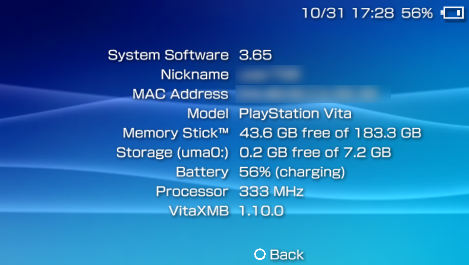 <br> **System Information** (nickname and MAC blurred) | 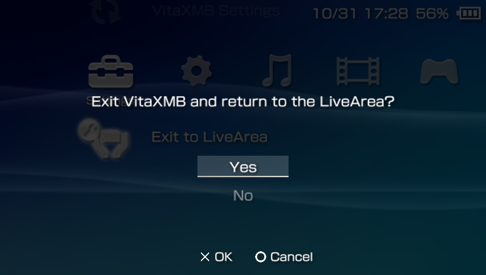 <br> **Confirmation dialog** |
| 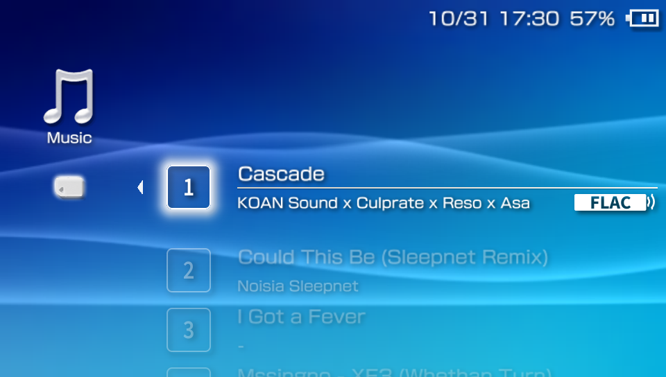 <br> **Music** - track list with ID3 tags | 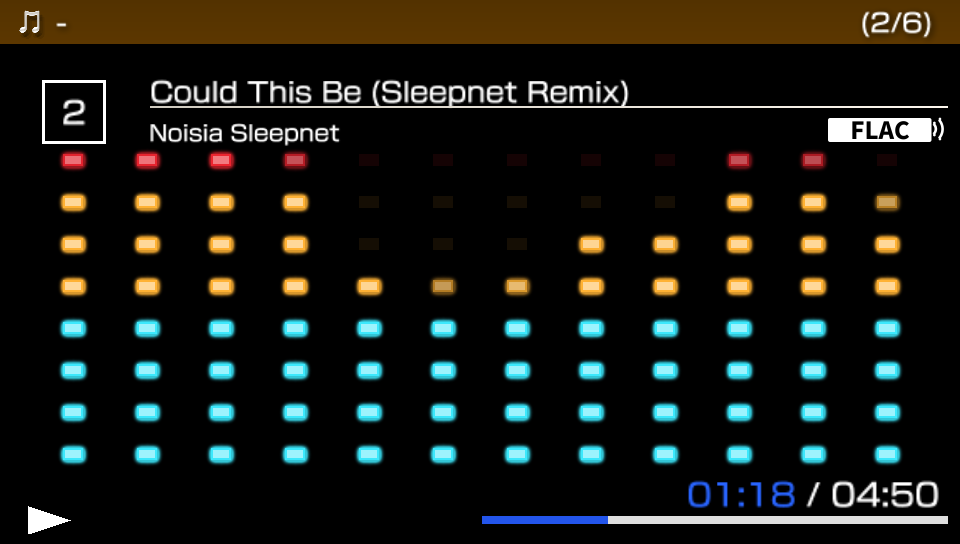 <br> **Music player** - real-time LED spectrum |
| 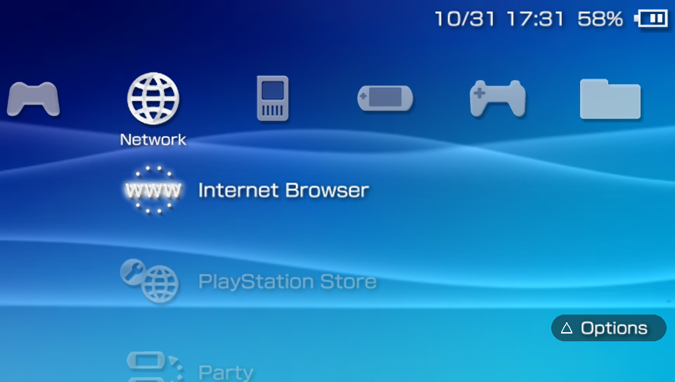 <br> **Network** - the Vita's online apps | |

## Controls

| Button | Action |
|---|---|
| D-pad / left stick **Left, Right** | Change category. Inside a Settings page: **Left** goes back, **Right** changes the selected value |
| D-pad / left stick **Up, Down** | Move through the list (hold to repeat) |
| **L / R** | Jump five rows |
| **Cross** | Open / start / change a value |
| **Circle** | Back, close a page or dialog |
| **Triangle** | Options (on a game, a folder, saved data, or any row of a column) |

**Touch screen.** Everything also works with a finger:

- **Drag up or down** scrolls the list, **drag left or right** changes the category; in a folder or a Settings page a swipe to the right goes back.
- **Tap** a row to select it and tap it again to open or start it; tap a category icon to go there; tap the arrow or the column at the left to go back.
- **Press and hold** a row for its Options. In the Options panel tap an entry (a tap outside closes it); in a dialog tap **Yes** or **No**; a tap closes an information page.

Music player: **Cross** play/pause, **L / R** previous/next track, **Left / Right** seek 10 s, **Circle** leave the player (the music keeps playing).

Video player (beta): **Cross** play/pause, **Circle** stop and go back, **Triangle** the control panel (the **d-pad** chooses, **Cross** uses, **Circle** closes), **Square** screen mode, **L / R** previous/next, **Left / Right** a tap jumps 10 s and holding searches (faster the longer you hold), **Start** help, **Select** information. On the touch screen a tap shows the display and a swipe seeks.

## Installing

VitaXMB is an *unsafe* homebrew (it reads other apps' folders and launches other titles), so it needs a hacked Vita with **HENkaku / Enso** and *Enable Unsafe Homebrew* switched on.

1. Build `VitaXMB.vpk` (see below) or take it from a release.
2. Copy it to the Vita and install it with VitaShell (Cross on the file, then confirm).
3. Start **VitaXMB** from the LiveArea. Settings are saved in `ux0:data/VitaXMB/config.bin`; failures are logged to `ux0:data/VitaXMB/log.txt`.

## Starting VitaXMB when the Vita turns on

Two small community plugins make VitaXMB the first thing you see: **AutoBoot** starts an app as soon as the Vita has booted, and **NoLockScreen** removes the swipe-to-unlock screen. Neither is part of VitaXMB and both are optional.

**Using the NoLiveArea plugin?** VitaXMB's own [NoLiveArea plugin](#nolivearea-plugin-beta) also starts VitaXMB about 8 seconds after the Vita turns on, so AutoBoot becomes optional; keeping it as a fallback does no harm (the plugin skips its launch once an app is already running). NoLockScreen is still needed, because the plugin does not touch the lock screen.

**1. Install the plugins.** The easiest way is [**AutoPlugin 2**](https://github.com/ONElua/AutoPlugin2), a plugin manager: install AutoBoot and NoLockScreen through it and it registers them for you, so you do not have to edit `tai/config.txt`. Both are also on [VitaDB](https://www.rinnegatamante.eu/vitadb/#/).

**2. Tell AutoBoot to start VitaXMB.** In AutoPlugin 2 open **Extras > AutoBoot > Select App** and pick **VitaXMB** from the list. That is all.

Or do it by hand: AutoBoot reads the **title ID** of the app, not its name. Open `ux0:data/AutoBoot/boot.cfg` (create it if it does not exist) and make its only content:

```
VXMB00001
```

No spaces, no extra lines. Typing `VitaXMB` does not work: the Vita identifies apps by their title ID, the folder name under `ux0:app/`. VitaXMB is `VXMB00001`.

**3. NoLockScreen.** Nothing to configure when it was installed through AutoPlugin 2. Use version 2.0 or newer: it also skips the lock screen at boot (older versions only skip it when you wake the Vita). If you install it by hand, copy `nolockscreen.suprx` to `ux0:tai/` and add `ux0:tai/nolockscreen.suprx` under `*main` in `tai/config.txt`. See [NoLockScreen on GameBrew](https://www.gamebrew.org/wiki/NoLockScreen_Vita). Note that it also bypasses any passcode you have set, so anyone who picks up the Vita can use it.

**If it does not start:**

- VitaXMB must be installed (its bubble is on the LiveArea) and **Enable Unsafe Homebrew** must be on in the HENkaku settings.
- Check that `boot.cfg` holds exactly `VXMB00001`.
- Hold **L1** while the Vita boots to skip plugins, and look at the plugin list in AutoPlugin 2.
- A plugin that starts an app at boot can fire before the system is ready; some builds have a delay setting.

## Building from source

You need the [VitaSDK](https://vitasdk.org/) plus these libraries from its package manager:

```sh
vdpm vita2d libpng libjpeg-turbo freetype harfbuzz zlib bzip2 taihen mbedtls
```

The video player needs FFmpeg, built once from source because no prebuilt Vita package has the video decoders (H.264, HEVC, VP9 ...). Download the FFmpeg 9.0.2 source from <https://ffmpeg.org/releases/> and run:

```sh
tools/build_ffmpeg.sh path/to/ffmpeg-9.0.2 third_party/ffmpeg-vita
```

It needs GNU make and a POSIX shell, takes a few minutes and leaves about 10 MB of static libraries in `third_party/ffmpeg-vita` (not committed; `-DFFMPEG_DIR=` points CMake somewhere else). It applies one small patch, `tools/ffmpeg_vita_patch.py`: FFmpeg's decoder threads get a 1 MB stack, because the Vita's default is too small for H.264 and crashes. On Windows with only the VitaSDK installed, set `HOST_CC=true` (the libraries need no host tools, only the configure checks do) and point `TMPDIR` at a POSIX path.

Then, with `VITASDK` set:

```sh
cmake -S . -B build          # add  -G Ninja  if you use Ninja
cmake --build build
```

The result is `build/VitaXMB.vpk` (and `build/VitaXMB.self`, the `eboot.bin`).

Notes

- On Windows the prebuilt VitaSDK toolchain works with CMake and Ninja (`pip install ninja`); `vdpm` needs a POSIX shell, or you can unpack the package archives from <https://github.com/vitasdk/packages> into the SDK yourself.
- The build links a tiny *weak* import stub (`third_party/vitashell_stub`) for the optional artwork-decryption feature; it is harmless if VitaShell's modules are not present.
- The executable is built with the same auth ID VitaShell uses (`-a 0x2808000000000000`, see `CMakeLists.txt`) so it may start other titles.

## How it works

```
                     +-------------------+
   pad / remote ---> |  main loop (60fps)|----> vita2d (GXM)  <--- text engine (FreeType + HarfBuzz atlas)
                     +---------+---------+
        icon_thread  <---------+---------> bg_thread   (full-screen backgrounds)
        music_thread <---------+---------> audio_thread (mixer: UI sounds + music ring)
                               +---------> dec_thread   (optional artwork decryption)
```

- **Layouts.** Every list is a `Menu` of `Item`s. A menu is drawn by one of three layouts: the category *column*, the wide-tile *game folder*, or the Settings-style *sub list* (`menu_layout()`); transitions between them are eased values (`folder_t`, `sub_t`, `page_t`, `dlg_t`, `opt_t`).
- **Selection emphasis** (brightness, glow, rule) follows an eased per-item `glow` value, not the slide position, so a row lights up the moment it is selected.
- **Art loading.** Rows near the cursor ask the loader thread for their art; it resolves LiveArea files, decodes and downscales PNGs off-thread, and the render thread uploads at most two per frame.
- **Text.** HarfBuzz shapes each string (kerning); glyphs are rasterised by FreeType at four sub-pixel phases into a padded atlas together with a blurred shadow bitmap, then drawn as textured quads.
- **Music.** minimp3 (MP3), dr_flac (FLAC), stb_vorbis (Ogg) and a small PCM reader (WAV, AIFF) decode on their own thread, streaming from the card through a 64 KB window, into a 48 kHz ring buffer; the audio mixer drains it alongside the UI sounds and publishes the last 1024 samples, from which a Goertzel filter bank computes the 12 spectrum bands.
- **Video.** MP4 / MOV / M4V / 3GP files go to the Vita's own player library (SceAvPlayer, hardware H.264 and AAC; its YUV frames are drawn straight through a GPU colour-conversion texture, and its audio is pulled into the same mixer ring). Everything else, and anything that library refuses, goes to FFmpeg: a reader thread, a video decoder thread and an audio decoder thread, with the audio position as the clock. Both engines share the control panel (`src/ui/videoui.h`).
- **Safety.** Textures are freed on a deferred list after the GPU has gone idle (freeing a texture the GPU still reads crashed the Vita).

### Fonts

The font clone shipped in `assets/font.otf` has been **baseline-normalised**. The original design places flat letters about 17 units below the baseline, round letters 35 units below it, and gives x-height and cap-height tops that differ per glyph. At 20-28 px those fractions get rounded into whole pixel rows, so for instance an *m* looked a row higher than an *a* or *e*. The shipped file remaps every Latin glyph's y-coordinates through one piecewise-linear function that collapses each alignment zone to a single value (baseline 0, x-height 596, cap height 782). Verified on the device by rendering all 94 ASCII glyphs at 20, 22, 24 and 28 px and measuring every glyph's top and bottom pixel row: all aligned.

Any OpenType/TrueType font can be dropped in as `assets/font.otf`.

## PSP games

VitaXMB lists the PSP and PS1 games Adrenaline can run, even those that have no LiveArea bubble:

- **Where it looks:** ISO and CSO files in `ux0:pspemu/ISO`, and every `EBOOT.PBP` in a folder of `ux0:pspemu/PSP/GAME` (homebrew and PS1 games). The title comes from the game's `PARAM.SFO`; ICON0 and PIC1 are cached in `ux0:data/VitaXMB/psp` after the first read. A game that already has a bubble is not listed twice.
- **Video and sound:** a game's `ICON1.PMF` replaces its icon while the cursor rests on it, and its `SND0.AT3` plays as music, as on the PSP. It is read straight from the ISO / CSO / PBP.
- **Starting a game without a bubble:** Adrenaline 8 has no way to start an ISO by itself, so VitaXMB uses Adrenaline's *Autorun*: it puts a small PSP program (`ux0:pspemu/PSP/GAME/BOOT/EBOOT.PBP`) in place, sets Adrenaline's start-program option, and starts Adrenaline. The PSP program mounts the game and starts it. VitaXMB puts Adrenaline's option back the next time it starts. If you have the AdrBubbleBooter modules installed, VitaXMB uses a bubble for the games that have one.
- Adrenaline's own LiveArea bubbles keep working as before.

## Languages

*Settings > System Settings > System Language* chooses *Automatic* (the Vita's language, English when it is not in the list below) or one of the 12 languages the PSP has. The change is immediate and is saved.

| Language | Language |
|---|---|
| Japanese (日本語) | Dutch (Nederlands) |
| English | Portuguese (Português) |
| French (Français) | Russian (Русский) |
| Spanish (Español) | Korean (한국어) |
| German (Deutsch) | Traditional Chinese (繁體中文) |
| Italian (Italiano) | Simplified Chinese (简体中文) |

These are exactly the PSP's languages. The Vita's other languages (Finnish, Swedish, Danish, Norwegian, Polish, Turkish, Brazilian Portuguese and so on) are not offered; with *Automatic* they show English.

**Feedback on the translations is very welcome.** The words the PSP firmware has come from the firmware itself, but the texts VitaXMB adds (its own settings, the updater, the Memory Stick counts and a few dialogs) were translated by hand and may sound wrong or unnatural in places, and some entries may still show in English. If you speak one of these languages and see a mistake, please [open an issue](https://github.com/dekiller82/VitaXMB/issues) with the language, the text as shown and what it should say. The files are plain text (`assets/lang/<code>.lng`, one `English<TAB>translation` per line), so a corrected file is just as welcome.

- The words of the XMB (categories, the Settings pages, dialogs, the Options panel, the Memory Stick lists and their counts) come from the PSP 6.60 firmware's own language tables, so they read as they do on a PSP. Texts the PSP never had (VitaXMB's own settings, the updater, the NoLiveArea page) are translated by hand.
- Japanese uses the firmware's `jpn0.pgf` font; Korean and Simplified Chinese use the Vita's own system fonts (the PSP's Korean font stores its letters in a form VitaXMB cannot read).
- Titles of games, saves, songs and videos are shown as they are.
- Tools to rebuild the language files from a firmware dump are in `tools/lang`.

## Game artwork

Rows show the landscape *gate* image of the app's LiveArea and, on rest, its background. They are found in this order: the app's own `sce_sys/livearea` (homebrew), LiveArea's copy in `ur0:appmeta/<id>/livearea`, and the plain `pic0.png` copy in `ur0:appmeta/<id>`.

Retail games' own files are encrypted, and the Vita only keeps `appmeta` copies for roughly 500 bubbles. For games without one, run **[CopyIcons](https://github.com/cy33hc/copyicons)** once: it copies each game's `pic0.png`/`icon0.png` into `ur0:appmeta`, and VitaXMB picks them up. Any app whose only picture is square (or portrait) gets a landscape tile made from it, in every list and column: its own colors blurred and dimmed as the fill, the icon centred on top with the Vita's rounded corners.

An experimental *Decrypt Artwork (beta)* setting (off by default, asks for confirmation) can mount a game's encrypted files through VitaShell's own kernel modules, as CopyIcons does, and cache the plain copies. It loads kernel modules and has frozen a test device, so treat it as an experiment.

## Music and video

**Music**

- Plays **MP3, FLAC, WAV, AIFF and Ogg Vorbis**. The system blocks apps from reading `ux0:music`, so VitaXMB scans **`ux0:pspemu/MUSIC`** (Adrenaline's folder). Put your songs there.
- Titles and artists come from the file's tags: ID3 (MP3), Vorbis comments (FLAC, Ogg), the INFO block (WAV) and NAME / AUTH (AIFF); without tags the file name is the title.
- Opus files, compressed AIFF-C and files with more than two channels (FLAC) are not supported.

**Video player (beta)**

- Videos are listed from `ux0:pspemu/VIDEO` and play inside VitaXMB.
- **MP4, M4V, MOV, 3GP:** played by the Vita's own player library: hardware H.264 and AAC, no waiting, smooth up to 720p. If that library cannot open the file (HEVC, a picture bigger than 720p, ...), VitaXMB tries FFmpeg.
- **MKV, WebM, AVI, WMV / ASF, FLV, TS, M2TS, MPEG / VOB, OGV and others:** FFmpeg, in software: H.264, HEVC, VP8, VP9, MPEG-4 (Xvid / DivX), MPEG-2, VC-1 / WMV with AAC, AC-3, E-AC-3, DTS, MP3, FLAC, Opus, Vorbis, WMA and more. Software decoding is meant for small pictures (around 480p and below); expect bigger ones to stutter.
- A video bigger than 720p, or one that has to be decoded in software at a larger size, shows a warning first and plays only if you choose to.
- The control panel (Triangle) is the PSP video player's, laid out and worded like its manual: *Audio Options* (tracks, and left / right / both channels), *Subtitle Options*, *Go To* (a time), *Screen Mode* (Normal, Zoom, Full Screen, Original, 4 : 3), *Display* (shows or clears the status: title, clock, state, chapter and time), *Help*; *Previous* (returns to the beginning first, or the chapter's start) and *Next*; *Fast Reverse* and *Fast Forward* (Cross cycles three speeds); *Slow Motion*, *Frame Advance*, *Play*, *Playback Speed (+) / (-)*, *Pause*, *Stop*; *A-B Repeat*, *Repeat* (Title, Folder, Off), *Shuffle* and *Clear* (resets repeat, A-B repeat and shuffle). Icons the video cannot use are not shown. Where you stopped is remembered and playback resumes there.
- Subtitles: text subtitles inside the file (SRT, ASS, MOV text) and a `.srt` / `.ass` / `.vtt` file next to the video with the same name. Picture subtitles (DVD, PGS) are not shown.
- Slow motion, frame advance and playback speed work for videos decoded by FFmpeg, not for the hardware player's (MP4 / MOV), and they play without sound.
- Beta: expect rough edges. Not done yet: hardware decoding for MKV / AVI, *Scene Search*, *Chapter Repeat*.

## Columns, folders and moving apps

**Warning: columns of your own, and the extra columns, do not work with every custom theme.** A PSP theme is made for the PSP's six columns. A theme that paints the whole category bar (full-height panels or strips, such as the Xbox 360 and Euphoria style themes) has no picture for Emulators, Utilities or a column you made: while such a theme is on, those columns are hidden and their apps are shown in **Game** instead. Other themes show the new columns with VitaXMB's own icons, which will not match the theme's artwork. Reordering or renaming columns can also make a theme's painted look wrong. If a theme looks broken, switch it off (*Settings > Theme Settings > Custom Theme > Off*) or keep to the six standard columns.

### Tutorial: tidy your Vita in a few minutes

1. **Let VitaXMB sort for you.** *Settings > VitaXMB Settings > Sort Apps into Columns*, then **Yes**. Emulators, utilities, music, video and network apps move to their own columns; games stay in Game. Nothing is deleted, and whatever it guesses wrong you fix in step 2.
2. **Move one app.** Highlight it (for example in *Game > Memory Stick™*), press **Triangle** and choose **Move to...**. Pick a column (or a folder under it) and press **Cross**. A line at the top confirms where it went.
3. **Move many apps.** Press **Triangle** on any row of a column and choose **Organize Apps**. Tick apps with **Cross** (**Square** ticks all or none), press **Triangle** (*Move Selected*), pick the place and press **Cross**.
4. **Make a folder.** **Triangle > New Folder**, type a name, then tick the apps that belong in it and press **Circle**. Faster: in **Move to...** press **Triangle** to make a folder in the column you are looking at; it is selected for you, so one more **Cross** puts the app in it. Folders can be renamed, moved to another column (**Move Folder to...**) and deleted (the apps stay installed) from their own Options.
5. **Make a column of your own.** *Settings > VitaXMB Settings > Arrange Columns* (or **Triangle > Arrange Columns** on a column's rows), go to the last row, **New Column**, and type a name. Then move apps into it with **Move to...** or **Organize Apps**.
6. **Arrange the bar.** In *Arrange Columns*: **Cross** picks a column up, **Up / Down** carries it, **Cross** drops it; **Square** renames, **Triangle** shows or hides, **L / R** change the picture, **Start** deletes a column of your own (its apps go to Game). **Circle** closes and saves.

Starting over is easy: delete `folders.txt` and `columns.txt` in `ux0:data/VitaXMB` (every app goes back to Game, the bar to its original order).

Every installed app lives in exactly one place: a **column** of the bar, and inside it optionally one of your **folders**. New apps start in **Game > Memory Stick™**. The columns are Photo, Music, Video, Game, Network and two that appear on their own: **Emulators** and **Utilities** show up as soon as an app is in them and go away when they are empty (in *Settings > VitaXMB Settings*, *Emulators Category* and *Utilities Category* can also be set to Hidden). Apps placed in a column are listed in that column itself, as rows like the *Last Played* disc under Memory Stick: a game icon until the cursor is on the row, then the game's own picture with the title beside it. Folders sit above them and open the wide list. Game keeps using Memory Stick.

### Arranging the columns

*Settings > VitaXMB Settings > **Arrange Columns*** (or **Options > Arrange Columns** on a column's rows) lists every column in the order of the bar. **Cross** picks a column up, **Up / Down** carries it to a new place, **Cross** drops it. **Square** renames it (with the Vita's keyboard), **Triangle** shows or hides it (Settings and Game always stay; Emulators and Utilities say *Automatic* while they are on the bar only when something is in them), **L / R** change its picture (18 to choose from). The last row, **New Column**, makes a column of your own (up to four); select one and press **Start** to delete it (its apps and folders go to Game). Every choice is kept in `ux0:data/VitaXMB/columns.txt`. A PSP theme that draws the bar as full-height panels or strips cannot show columns of its own or Emulators and Utilities; with such a theme their apps are shown in Game.

### Moving apps

- **Move to...** is in the Options (Triangle) of every app. A list shows every column with your folders under it, how many apps each holds, and where the app is now. **Cross** moves it there, **Triangle** makes a **New Folder** in the highlighted column on the spot (you name it with the Vita's keyboard and it is selected, so one more **Cross** puts the app in it), **Circle** cancels (a folder made there and left empty is removed again). A move is confirmed with a line at the top of the screen.
- **Organize Apps** (Options on any row of a column, or *Settings > VitaXMB Settings*) lists every app with the place it is in. **Cross** ticks, **Square** ticks all or none, **Triangle** moves what is ticked (or the highlighted app when nothing is ticked) through the same Move screen, **Circle** closes.
- **Sort Apps into Columns** (*Settings > VitaXMB Settings*, and offered once at the first start with this version) moves emulators, utilities, music, video and network apps to their columns by name and title ID: for example RetroArch, PPSSPP and Adrenaline go to Emulators, VitaShell and Checkpoint to Utilities, ViTube and VLC to Video, music players to Music, Moonlight, Cordless and VitaRPS5 to Network. It asks first, never touches an app you already placed yourself, and never moves retail games or PSP / PS1 games. It is a guess from the name: whatever it gets wrong, Move to... fixes.

### Folders

- **New Folder** (Options on any column's row, on Memory Stick's games or on a folder) asks for a name and creates the folder in that column, then opens the picker.
- The **picker** lists every installed app with a tick box. **Cross** ticks or unticks, **L / R** jump five rows, **Triangle** selects all or none, **Circle** saves and closes. An app that is already in another folder shows where; ticking it moves it here.
- On a folder (or inside one): **Select Games** reopens the picker, **Rename Folder**, **Move Folder to...** (to another column, with everything in it; the screen follows it there), **Delete Folder** (asks first; the apps stay installed and return to the folder's column). Inside a folder, **Remove from Folder** takes the highlighted app out.

Everything is stored in `ux0:data/VitaXMB/folders.txt` (plain text: an `F` line per folder with an optional `C` line for its column and `A` lines with title IDs, and `P` lines for apps placed straight in a column), so it survives uninstalling and reinstalling an app. The file of an older version still loads. 

## Trophies

Trophy progress is read from the Vita's own trophy database, so it matches the LiveArea's trophy bubble.

- **Game > Trophy Collection** lists every game with trophies by name with its progress (for example *37%   19 / 51*). **Cross** opens a game's trophies.
- On any game, **Options > Trophies** goes straight to that game's trophies.
- A game's page shows its picture, a progress bar with the percentage, how many platinum, gold, silver and bronze trophies you have of how many exist, and every trophy with its grade-coloured cup, name, description and the date you got it. Locked trophies are dimmed; hidden ones stay hidden until unlocked. **Up / Down** scroll, **L / R** jump five, **Circle** goes back.

The list shows the games the Vita knows trophies for, installed or not. A game that has never synced trophies shows "No trophy data for this game yet".

## Updates

VitaXMB can update itself from its GitHub releases (`dekiller82/VitaXMB`).

- **Settings > Network Update** (the first item) checks for a newer release, shows its release notes (scroll with Up / Down or L / R) and installs it. With **Check for Updates at Start** on (*VitaXMB Settings*, on by default), a notice appears a few seconds after startup when a newer release exists.
- Installing closes VitaXMB, hands over to a small bundled app (*VitaXMB Updater*) that shows a progress screen, installs the package and starts VitaXMB again. The updater app is installed automatically the first time and refreshed when it changes.
- The download uses its own HTTPS client, because the Vita's built-in SSL library cannot complete a handshake with GitHub.
- Installing needs VitaShell's modules in `ux0:VitaShell` (the same ones VitaShell uses to install packages). If the system installer refuses the package, the downloaded `.vpk` is kept in `ux0:data/VitaXMB/` so you can install it with VitaShell.
- Tags are compared as `major.minor.patch` (`v1.2.0`, `1.3`); keep minor and patch under 100.

## Custom themes (beta)

> **Columns of your own and the Emulators / Utilities columns do not work with every custom theme**: a theme that paints the whole category bar has no picture for them, so they are hidden and their apps show in Game. See [Columns, folders and moving apps](#columns-folders-and-moving-apps).

**This is a beta. Please test it and tell me what you see.** VitaXMB can load the PSP's custom themes (`.ctf` and `.ptf`, the 6.60 / 6.61 CXMB kind). Put theme files in `ux0:data/VitaXMB/themes` (or `ux0:pspemu/PSP/THEME`) and choose one under *Settings > Theme Settings > Custom Theme (beta)*. Choosing *Off* returns to the stock look.

What is read from a theme today:

- **Look:** wallpaper or the month's sky (the set the real XMB loads on a PSP-3000 and later), the colour pictures, text and icon colours, icon sizes and the theme's font.
- **Background and boot:** the wave (a theme's own model, or none), the boot intro and the XMB sounds.
- **Category bar and lists:** icons, spacing, gap and move speed of the bar, strip, panel and text-list layouts, the row spacing of every list and how fast lists scroll, and how far the bar slides aside when a list opens. These come from the theme's code patches for `paf.prx`, `vshmain.prx` and `common_gui.prx`, which VitaXMB reads and applies.
- **Text:** the size of the sub text under a row and of the Options text, and the text shadow, as the theme sets them.
- **Status bar:** the clock (position, size, opacity and colour), the battery and its charging animation, the mute icon and the busy spinner, in the theme's own pictures or the PSP's.
- **Pictures:** the Options panel and game list positions (including a folder's Options), the separator line, arrows, check boxes, the glow behind the selected row, shadows, the button glyphs and their colours, and the loading and broken pictures of game and save rows.
- **3D themes** that turn the whole XMB in space.
- **Random:** choose *Random* at the end of the Custom Theme list to get a different theme at every start.

Not supported yet: some theme layout constants whose meaning needs a real PSP to check against, the special-date skies, the game boot video, fonts other than the main one, and themes made for firmware other than 6.60 / 6.61. The PSP's keyboard, HOME menu and volume overlay are drawn by the Vita itself and are not themed.

A PSP theme is partly code (patches to the PSP's own modules), which the Vita cannot run, so VitaXMB reads what the theme *says* and imitates the rest. Some themes will look different from the real PSP, and some parts are not supported yet.

**Please help by reporting what is wrong.** Open an [issue](https://github.com/dekiller82/VitaXMB/issues) with:

- the theme's name and where you got it,
- a **screenshot from VitaXMB**,
- if you can, a **reference of the same screen on the real PSP XMB** (the same menu, the same selected item). You don't need a PSP: run the theme in **Adrenaline** on your Vita (it runs the PSP's own XMB) and take a screenshot there, or photograph a real PSP,
- what looks wrong (position, colours, sounds, animation, a crash).

The PSP reference is the most useful part: it shows what the theme is supposed to look like, which the theme file alone does not. Themes are not included in this repository; they belong to their authors.

## Extra storage (experimental)

**Beta, off by default. Please test it and report what you see.** If a storage manager (StorageMgr, YAMT and similar) mounts a second card as `uma0:`, `imc0:`, `xmc0:` or `grw0:`, the *Extra Storage (beta)* setting makes VitaXMB also look there:

- music in `<card>/music` and `<card>/pspemu/MUSIC`
- videos in `<card>/video`, `<card>/pspemu/VIDEO` and `<card>/Movies`
- a *Storage (<card>)* row with free and total space in System Information

The setting shows what it found (`Off`, `On (none)`, `On (uma0:)`, `On (N cards)`). Duplicates are skipped, because memory cards ignore letter case.

Tested on one console: an SD2Vita as `ux0:` plus a real memory card mounted as `uma0:`; its music is listed and playable. Not tested: videos from a second card, other mount names, and games or saved data on the second card (the game list still reads `ux0:app` only).

## Settings reference

**Settings > VitaXMB Settings**

| Setting | Values | Notes |
|---|---|---|
| Clock Format | 24-hour / 12-hour | status bar |
| Battery Percentage | Off / On | shows the battery level as a number (for example 86%) beside the clock; off by default |
| Sound Effects | On / Off | UI sounds and music mixing are independent |
| Startup Animation | On / Off | the PSP boot animation, played once each time the console starts (not every time VitaXMB opens), then fade in + slide in |
| Game Boot Logo | PSV / PSP | the logo laid over the game boot movie when a game starts: **PSV / PlayStation Vita** (default) or **PSP / PlayStation Portable** (the PSP's own picture) |
| System Language | Automatic / the 12 PSP languages | *System Settings* page; see [Languages](#languages) |
| No LiveArea Plugin (beta) | On / Off | installs / removes the bundled NoLiveArea plugin, see [NoLiveArea plugin](#nolivearea-plugin-beta); needs a restart |
| Confirmation Dialogs | On / Off | asks before leaving the XMB |
| Game Launch Method | A-D | the system call and flag used to start a title |
| Photo / Music / Video / Network Category | Shown / Hidden | hides that category from the bar; Settings and Game always stay |
| Arrange Columns | (opens) | reorder, rename, hide, change the picture of, add and delete columns |
| Emulators / Utilities Category | Automatic / Hidden | Automatic shows the column once an app is in it; see [Columns, folders and moving apps](#columns-folders-and-moving-apps) |
| Organize Apps | (opens) | every app with its place; tick some and move them together |
| Sort Apps into Columns | (asks) | puts emulators, utilities, music, video and network apps in their columns; never moves what you placed yourself |
| Check for Updates at Start | On / Off | looks for a new release a few seconds after startup, see [Updates](#updates) |
| Extra Storage (beta) | On / Off | experimental, see above |
| Decrypt Artwork (beta) | On / Off | experimental, see above |

## NoLiveArea plugin (beta)

VitaXMB carries an optional taiHEN plugin, **NoLiveArea** (source in `plugin/nolivearea`, built file in `assets/plugin`). It runs inside the system shell and keeps the LiveArea out of sight: the shell's picture is kept invisible while the console starts, while a game starts and when a game closes, VitaXMB is started about 8 seconds after the console turns on, and it comes back when a game ends. (Older versions switched the screen off instead; that is still the fallback when the shell is not the expected version.)

Since 1.7 the plugin also watches the shell's own list of running apps, using only public calls. VitaXMB leaves a small marker file (`ux0:data/VitaXMB/launch.req`) when it starts a game; if that game ends without the shell reporting it, VitaXMB is still brought back, and if a launch of VitaXMB only opens its LiveArea page the plugin launches it once more. The release plugin is also smaller: its debug hooks and event logging are only built with `-DNLA_DEBUG=ON`.

- The first time VitaXMB runs it asks whether to install the plugin. Install or remove it any time in *Settings > VitaXMB Settings > No LiveArea Plugin (beta)*.
- Installing copies `NoLiveArea.suprx` to `ur0:tai/`, adds one line under `*main` in `ur0:tai/config.txt` (the first copy of your config is kept as `config.txt.bak_nolivearea`) and creates its switch files in `ux0:data/NoLiveArea`. Restart the Vita afterwards; taiHEN reads the list at start.
- Kill switch: an empty file named `disable` in `ux0:data/NoLiveArea` stops it. Removing it from the Settings row deletes the config line again. An empty file `return.off` in `ux0:data/VitaXMB` turns off only the 1.7 safety net and retry.
- Fail-safe (1.7.1): if `ux0:app/VXMB00001` is missing (VitaXMB uninstalled, or an update that did not finish) the plugin launches nothing and hides nothing, so a closed app is not answered with "can't find the app". It resumes by itself when VitaXMB is installed again.
- Updates: when VitaXMB is updated, the next start copies the bundled plugin over the installed one and shows a **Restart required** screen that says what changed in the plugin; the new build only loads after the restart.
- Limits: tested on firmware 3.65 only. Pressing the PS button inside a game still opens the stock LiveArea (inside VitaXMB it no longer does). A plugin that edits the system shell can in the worst case make the console crash at start: keep a way to edit `ur0:tai/config.txt` from a PC (or use Safe Mode) before trying it.

**Settings > Theme Settings > Custom Theme (beta)**: Off or one of the PSP themes found, see [Custom themes (beta)](#custom-themes-beta).

**Settings > Theme Settings > Color**: automatic (follows the month, like the PSP) or any of the twelve months. October is measured from a real PSP capture; the other months are approximations.

**Settings > System Settings**: *System Information*, plus shortcuts to the Vita's own Settings pages.

## Development

Release builds contain no debugging code. Configure with `-DVITAXMB_DEBUG=ON` to add:

- `ux0:data/VitaXMB/trace.txt`: breadcrumbs, slow-frame timings (`input / icons / draw / swap`) and launch results.
- A file-based **remote control**: write space-separated commands to `ux0:data/VitaXMB/remote.txt` and the app executes one per frame, then deletes the file. Commands: `left right up down cross circle triangle l r`, `w<frames>` (wait), `shot:<name>` (save `ux0:data/VitaXMB/<name>.png`), `page:text` / `page:off` (glyph test page), `hint:<0-3>` (text hinting mode), `uri:<hexflags>:<uri>` (try a launch request).
- This is how the screenshots and the demo GIF in this README were captured, over an FTP connection to the console.

## Repository layout

```
CMakeLists.txt            build definition (VPK, SELF, assets)
src/main.c                the launcher: main loop and input
src/core/                 data, config, items and menus, game scanning, artwork, settings, the updater, folders and columns (folders.h: where every app lives, the sort, columns.txt), trophies (trophy.h)
src/media/                sound mixer, media scan, music player, video engines (video.h: FFmpeg, avp.h: the system player), the game boot movie (gameboot.h)
src/render/               textures, drawing, text engine, backgrounds, waves
src/theme/                PSP theme loader, RCO runtime, boot intro, theme sounds, the PSP engine's list styles and easing (paf.h)
src/ui/                   layouts, lists, pages, dialogs, pickers, Move to... (mover.h), Arrange Columns (arrange.h), the trophy page, the video player screen (videoui.h)
tools/                    build_ffmpeg.sh (+ the stack-size patch), the scripts that made the music / video pictures, make_column_icons.py (the Emulators, Utilities and trophy icons), make_hires_icons.py (the 128 px XMB icons, made from the 64 px originals in tools/icons64)
updater/main.c            the small installer app (VitaXMB Updater)
psp/launcher/             the small PSP program that starts a game for Adrenaline (built with pspdev into assets/psp/vxmbboot.pbp)
assets/lang/              the language files (one per PSP language), made by tools/lang
assets/psp/               the PSP boot intro resource, the game boot movie (gameboot.h264) and the Vita boot logo (psv_logo.png); music/ and video/: the PSP's list and control-panel pictures at native size
plugin/nolivearea/        the NoLiveArea taiHEN plugin (the built file is assets/plugin/NoLiveArea.suprx)
sce_sys/                  bubble icon and LiveArea files of the VitaXMB app itself
assets/font.otf           baseline-normalised UI font
assets/icons/             PSP-style XMB icons (PNG, 128 px; the Settings wrench badge is 56 px)
assets/sounds/            XMB sound effects (48 kHz stereo PCM)
third_party/minimp3/      MP3 decoder (CC0)
third_party/dr_libs/      dr_flac (FLAC) and stb_vorbis (Ogg) decoders (public domain)
third_party/ffmpeg-vita/  FFmpeg libraries, built locally by tools/build_ffmpeg.sh (not committed)
third_party/vitashell_stub/  import stub + headers for VitaShell's user module
docs/                     README images
```

Everything in the tree is needed to build (apart from the FFmpeg libraries you build yourself); nothing else is committed.

## Changelog

Every release has its own notes and VPK on the [Releases page](https://github.com/dekiller82/VitaXMB/releases). Each version includes everything from the ones before it.

### [1.9.1](https://github.com/dekiller82/VitaXMB/releases/tag/v1.9.1) (2026-10-25)

**Changed**

- **Sharper icons.** Every XMB icon (the categories, the columns, the Settings rows and their wrench badge) is redrawn at twice the PSP's size, with the PSP's glassy shading and clean edges, so they no longer look blurry on the Vita's screen.
- **Opening and leaving a list or folder** follows the PSP firmware: the bar slides and the other categories fade in one 200 ms step (the firmware's own easing), and the apps under the category move with the bar at the same speed.
- **Apps with square art** (the VitaXMB Updater, YAMT, Simple Account Switcher and every other app whose only picture is its square icon) now get a landscape tile in every list and column, like the Game list's other entries: a blurred fill made from the icon itself with the icon centred on top, instead of a square in a dark frame.
- This release is built without any debug hooks (`VITAXMB_DEBUG` is off).

### [1.9.0](https://github.com/dekiller82/VitaXMB/releases/tag/v1.9.0) (2026-10-24)

**Warning:** columns of your own, Emulators and Utilities do not work with every custom theme. Themes that paint the whole category bar (full-height panels or strips, like the Xbox 360 and Euphoria style ones) have no picture for them: those columns are hidden while such a theme is on and their apps appear in Game. Other themes show them with VitaXMB's own icons, which will not match the theme. Switch the theme off (*Settings > Theme Settings > Custom Theme > Off*) to see your columns.

**New**

- **Your apps where they belong.** Any app can live in any column: Photo, Music, Video, Game, Network, and two new ones, **Emulators** and **Utilities**, which are on the bar only while something is in them. Apps placed in a column are rows like the *Last Played* disc (their own icon, then their picture and title when selected); every icon is loaded ahead. Columns can hold folders of their own, and a folder can be moved to another column. The old `folders.txt` still works.
- **Move to...** (Options on any app): a list of the columns and their folders showing where the app is now, with **New Folder** right there. **Organize Apps** ticks many apps and moves them together. **Sort Apps into Columns** (offered once at the first start, and in *Settings > VitaXMB Settings*) puts emulators, utilities, music, video and network apps in their columns and leaves your own choices and every retail and PSP game alone.
- **Arrange Columns.** Reorder, rename, hide and give another picture to any column (18 to choose from), and make up to four columns of your own, or delete them (their apps go to Game). Saved in `ux0:data/VitaXMB/columns.txt`.
- **Trophies without opening the LiveArea.** *Game > Trophy Collection* lists every game with its trophy progress; a game's Options has *Trophies*. The page shows the progress bar, how many platinum, gold, silver and bronze you have, and every trophy with its description and date (locked ones dimmed, hidden ones hidden). Read from the Vita's own trophy database, so it matches the LiveArea's.
- **Tutorial** in the README: [sorting, moving, folders and columns step by step](#tutorial-tidy-your-vita-in-a-few-minutes).

**Changed**

- Every text of the new features is translated into the PSP's 12 languages (by hand; **corrections welcome**).
- Options now show on every row of Photo, Music, Video, Network, Emulators, Utilities and the columns you made (New Folder, Organize Apps, Arrange Columns).

### [1.8.0](https://github.com/dekiller82/VitaXMB/releases/tag/v1.8.0) (2026-10-24)

**New**

- **Languages.** *Settings > System Settings > System Language*: Automatic (the Vita's language) or any of the PSP's 12 languages: Japanese, English, French, Spanish, German, Italian, Dutch, Portuguese, Russian, Korean, Traditional Chinese and Simplified Chinese. Other Vita languages are not included (Automatic shows English for them). The texts come from the PSP firmware's own language tables; VitaXMB's own settings are translated by hand, so **please report wrong or unnatural translations** (see [Languages](#languages)). Names of games, saves, songs and videos are not translated. Japanese uses the firmware's font, Korean and Simplified Chinese the Vita's system fonts.
- **PSP and PS1 games without a bubble.** Every ISO / CSO in `ux0:pspemu/ISO` and every `EBOOT.PBP` in `ux0:pspemu/PSP/GAME` is listed in *Game* with its real name, ICON0 and PIC1. They start through Adrenaline's Autorun with a small PSP launcher that ships inside VitaXMB; Adrenaline's start option is put back the next time VitaXMB starts.
- **PSP game video and sound.** On a PSP game, ICON1.PMF plays in place of the icon and SND0.AT3 plays as music, like the PSP's XMB (FFmpeg now includes the ATRAC3 / ATRAC3+ decoders).
- **The Last Played disc** shows the UMD until the cursor is on it, then changes into the game's landscape picture (and its video and sound), with the title beside it, in the size of the game list's tile.

**Changed**

- The *Memory Stick* lines (free space, song and game counts, "Open in Photos") and the Settings category names follow the chosen language.
- This release is built without any debug hooks (`VITAXMB_DEBUG` and the plugin's `NLA_DEBUG` are off).

### [1.7.2](https://github.com/dekiller82/VitaXMB/releases/tag/v1.7.2) (2026-10-23)

**Fixed**

- **The menu sounds are the PSP's own.** The cursor, confirm, cancel, category and option sounds were MP3 recordings, and confirm and cancel were not the right samples (confirm was the system's "OK" jingle, cancel a long low tone), which made them sound muffled next to a real PSP. They are now the samples from the PSP 6.60 firmware, resampled to the Vita's 48 kHz. They are short and quiet, as on the PSP.

### [1.7.1](https://github.com/dekiller82/VitaXMB/releases/tag/v1.7.1) (2026-10-21)

**Fixed**

- **NoLiveArea plugin 1.7.1: no more "can't find the app" when VitaXMB is gone.** If VitaXMB was uninstalled (or a failed update left it missing) while the plugin stayed in `ur0:tai/config.txt`, the plugin still tried to start VitaXMB every time an app closed, and the Vita answered that it could not find the app. The plugin now checks that `ux0:app/VXMB00001` exists before it launches anything, hides the screen or watches games, and does nothing when it does not. It starts working again by itself once VitaXMB is installed again. With the plugin installed, updating replaces its file and the **Restart required** screen tells you about this.
- If you are stuck with the old plugin and no VitaXMB, delete the line `ur0:tai/NoLiveArea.suprx` from `ur0:tai/config.txt` (edit it from a PC or with VitaShell), or reinstall VitaXMB from the Releases page.

**Changed**

- **The updater app is replaced by what is inside the package, not by a version number.** Last time the check compared a version string typed in two places, and they drifted apart. VitaXMB now stamps the checksum of the updater package it installed (`ux0:data/VitaXMB/updater.crc`) and installs the updater again whenever the package carried in the running VitaXMB has a different checksum, so any change to the updater (program or icon) arrives with the next update without anyone having to bump a number. The updater app itself is 01.07: after an install it waits a moment and starts VitaXMB once and leaves at once. (01.05 and 01.06 tried again up to four times, but a second launch while the updater was still running made the system ask "close the VitaXMB Updater?", so that retry is gone.) The updater of 1.7.0 and older is not replaced until you update *from* 1.7.1, so the first update to 1.7.1 is still done by the old one.

### [1.7.0](https://github.com/dekiller82/VitaXMB/releases/tag/v1.7.0) (2026-10-20)

**Added**

- **Game boot movie.** Starting a game now plays the PSP's own game boot movie (the blue wave, the white flash and the bokeh, about 2.5 seconds) with the start-game jingle and a logo laid over it, then starts the game. It is the firmware's real movie: 480 x 272, H.264, decoded in software and drawn at twice the size. If the clip cannot be opened, the old fade to black happens instead.
- **Game Boot Logo** in *Settings > VitaXMB Settings*: the logo over the movie is **PSV / PlayStation Vita** by default and can be switched to **PSP / PlayStation Portable**, the PSP's own picture, at any time.
- **NoLiveArea plugin 1.7.** It now also watches the shell's list of running apps: if a game started from VitaXMB ends without the shell reporting it, VitaXMB is still brought back (with the same hiding as before), and if starting VitaXMB only opens its LiveArea page, the plugin starts it once more. `return.off` in `ux0:data/VitaXMB` turns these two off. With the plugin installed, updating replaces its file and the **Restart required** screen now says what is new in the plugin.

**Changed**

- The **PS button** no longer drops to the LiveArea while VitaXMB is open (a long press still opens the quick menu). Use *Exit to LiveArea* in Settings to leave.
- The plugin in the release has no debug hooks and no per-event logging (they are only built with `-DNLA_DEBUG=ON`): it is about a third smaller and writes only a few lines to its log.

**Fixed**

- The **VitaXMB Updater** app on the Vita was never replaced when its package changed (1.6.1 gave it a new icon, but VitaXMB believed the old one was current, so it kept the old icon and version 1.03). The updater's version now comes from one number in `CMakeLists.txt` that is used for both the bundled package and the check, so an older updater on the Vita is replaced. Because the check lives in the new app, this happens the next time you update after 1.7.0.
- The **VitaXMB Updater** now brings VitaXMB back after an install (or a failed one). It used to start VitaXMB once and leave at once, and right after an install that first launch often only opened VitaXMB's LiveArea page. It now launches, checks that VitaXMB is running and launches again, up to four times.

### [1.6.1](https://github.com/dekiller82/VitaXMB/releases/tag/v1.6.1) (2026-10-19)

**Changed**

- New bubble icon, LiveArea background and start image. They are drawn from the app's own data: the blue August sky and the PSP's own wave, the film strip, controller and globe icons, and the name set in the PSP's font. The updater app's bubble uses the new icon too.

This release follows 1.6.0 closely; everything in 1.6.0 (below) is included.

### [1.6.0](https://github.com/dekiller82/VitaXMB/releases/tag/v1.6.0) (2026-10-18)

**Added**

- **Video player (beta).** Videos now play inside VitaXMB instead of opening the Vita's Videos app.
  - **MP4, MOV, M4V and 3GP** play with the Vita's hardware decoder (H.264 and AAC), start at once and run smoothly up to 720p.
  - **MKV, WebM, AVI, WMV, FLV, TS, MPEG, VOB and more** play too, decoded in software (H.264, HEVC, VP8, VP9, MPEG-4, MPEG-2, VC-1; AAC, AC-3, DTS, FLAC, Opus, Vorbis, WMA ...). Meant for small pictures; large ones stutter.
  - The PSP video player's **control panel** (Triangle), laid out and worded like the PSP's: three rows of icons with the selected one named underneath; *Display* shows the title and clock along the top and the state icon, time line, chapter and time along the bottom. It has play, pause, stop, previous / next, fast reverse / forward (three speeds), slow motion, frame advance and playback speed (software-decoded videos), *Go To* a time, repeat (title, folder), shuffle, A-B repeat and clear, audio options (tracks and left / right / both channels), subtitle options, screen mode (Normal, Zoom, Full Screen, Original, 4 : 3) and help. Without the panel, holding Left / Right searches and a tap jumps 10 seconds.
  - Subtitles from inside the file or from a `.srt` / `.ass` / `.vtt` file next to it, and **resume** where you stopped.
  - A **warning** before a video bigger than 720p (or a large one that has to be decoded in software) that the Vita will not play smoothly.
- **FLAC, WAV, AIFF and Ogg Vorbis** in the music player, next to MP3. Titles and artists come from each format's tags. Files are streamed from the card, so a large lossless file no longer has to fit in memory.

**Changed**

- The music list draws the PSP's own number box, digits and format tag at the Vita's native resolution (sharp instead of stretched), shows each file's format (MP3, FLAC, OGG, WAV, AIFF) and a dash for a track without an artist; the selected row's glow pulses.
- File names of videos longer than 110 characters now open.
- **NoLiveArea plugin (beta): a new way of hiding the LiveArea.** Instead of switching the screen off, the plugin keeps the system shell's picture invisible while the console starts, while a game loads and when a game closes. The display stays on, and VitaXMB comes back faster after a game closes (about 0.12 s instead of 0.4 s, and it tries again if the first launch fails). A 30 second safety timer always gives the shell's picture back. If the shell is not the one the plugin was written for (tested on firmware 3.65 only) or the hook cannot be installed, it falls back to the old way. If you have the plugin installed, updating replaces its file and VitaXMB asks you to restart.

### [1.5.1](https://github.com/dekiller82/VitaXMB/releases/tag/v1.5.1) (2026-10-12)

**Fixed**

- Adrenaline 8.0.2 (isage) could freeze the Vita when it was launched a second time from VitaXMB while the NoLiveArea plugin was installed. The plugin's black screen between apps ran while Adrenaline's kernel module was loaded. VitaXMB now tells the plugin when it starts Adrenaline, and the plugin skips the black screen for that launch (the LiveArea may show for a moment instead).

**Changed**

- Updating VitaXMB now also updates the NoLiveArea plugin file if you had installed it. The Vita keeps the plugin loaded in memory, so the new version only works after a restart. After updating, VitaXMB shows a "Restart required" screen with one button (Restart now) and no way to cancel, and shows it again each time VitaXMB opens until the console has restarted. Later updates that change the plugin do the same.

### [1.5.0](https://github.com/dekiller82/VitaXMB/releases/tag/v1.5.0) (2026-10-11)

- **NoLiveArea plugin (beta).** VitaXMB can install a small taiHEN plugin that keeps the LiveArea out of sight: VitaXMB opens by itself when the Vita turns on, the screen stays black while a game loads, and VitaXMB opens again when a game closes. It is offered once at the first start and can be installed or removed any time in Settings > VitaXMB Settings > No LiveArea Plugin (beta). The Vita asks to restart afterwards, because taiHEN only reads its plugin list at start. Tested on firmware 3.65 only; pressing the PS button inside a game still shows the stock LiveArea.
- The PSP start-up animation now plays once each time the console starts, not every time VitaXMB opens (after a game closes, for example).
- **Battery Percentage** (Settings > VitaXMB Settings): shows the battery level as a number beside the clock, off by default.

### [1.4.0](https://github.com/dekiller82/VitaXMB/releases/tag/v1.4.0) (2026-10-10)

- **Touch screen support** for the whole XMB. Drag up or down to scroll a list, drag sideways to change the category (a swipe to the right goes back inside a folder or a Settings page), tap a row to select it and tap it again to open it, tap a category icon to go there, and press and hold a row for its Options. The Options panel, dialogs, the folder picker, the Color and Custom Theme chooser, information pages and the music player can be used by touch as well.
- **Last played:** the game you started last now sits under Memory Stick in the Game column with the PSP's UMD icon, like the disc in a PSP's drive. Select it to start the game again, or press Triangle for Start and Information.

### [1.3.6](https://github.com/dekiller82/VitaXMB/releases/tag/v1.3.6) (2026-10-10)

- All Latin text now uses the PSP's own font (ltn0.pgf), and the clock is drawn in it at size 28. A custom theme's font still replaces it; text with a character the PSP font lacks falls back to the previous font.
- "Memory Card" is now "Memory Stick™" in the Game, Photo, Music and Video lists and in System Information.
- Opening Options on a game slides the bar and the game list to the left like the PSP does; the slide distance comes from the theme.
- The confirmation dialog fades in at the speed the theme sets.

### [1.3.5](https://github.com/dekiller82/VitaXMB/releases/tag/v1.3.5) (2026-10-08)

- Fixed: PSP and PS1 games (Adrenaline bubbles) showed only their first letter. VitaXMB now reads the real name from LiveArea's database.
- Fixed: the stock mute icon had a black box around it. The stock status pictures are now redrawn at 4x.
- Fixed: the charging animation did not move at higher battery levels. It now plays the firmware's sequence (empty, one bar, two, full) at every level.
- Fixed: the battery and mute icon sat about 2 px too high.
- New: long text in a row scrolls like the PSP's ticker on the selected row (Settings rows, game and category columns, folders).
- Custom themes: opening Options on a game slides the bar and the game list to the left using the theme's own patched values, and the confirmation dialog fades in at the speed the theme sets.
- The stock battery, mute icon and busy spinner use the firmware's pictures at higher resolution; a theme's own pictures are still used first.

### [1.3.4](https://github.com/dekiller82/VitaXMB/releases/tag/v1.3.4) (2026-10-08)

- Fixed: the busy spinner showed four copies of itself.
- The clock follows the theme: its position, size, opacity and colour. The mute icon sits next to it as the theme places it, and the legend text and button glyphs take the theme's colour.
- Text: the size of the sub text under a row, the Options text and the text shadow follow the theme.
- Pictures: a theme's glow behind the selected row, its shadows, its loading and broken pictures for games and save data, shadows behind the button glyphs.
- A folder's Options and the other lists' Options have their own positions, and a theme that hides the Options panel background is respected.
- New: choose Random at the end of the Custom Theme list to get a different theme at every start.
- README: the custom theme section lists what is supported and what is not yet.

### [1.3.3](https://github.com/dekiller82/VitaXMB/releases/tag/v1.3.3) (2026-10-08)

- Theme code patches are read correctly now (a bug made the app see only the first few). Row spacing of every list, list scroll speed, category move speed and how far the bar slides for a list follow the theme.
- The clock follows the position the PSP's own code gives it.
- Status bar: mute icon (volume at 0), a busy spinner while a game starts or an update downloads, and the battery charging animation. The pictures come from the theme, or from the PSP's own set.
- Month skies: the set the real XMB loads on a PSP-3000 and later (01-12_03g.bmp), for the stock look and for themes.
- Game lists hold up to 2048 entries.

### [1.3.2](https://github.com/dekiller82/VitaXMB/releases/tag/v1.3.2) (2026-10-08)

- Fixes games missing from the list on big libraries: the Games, Saved Data and folder lists now hold up to 2048 entries (was 256), and folder handling stays fast with that many apps.

### [1.3.1](https://github.com/dekiller82/VitaXMB/releases/tag/v1.3.1) (2026-10-05)

- **Text looks more like the PSP's.** The shadow behind the text is now a wide, soft, faint glow instead of a small hard one, and the letters have slightly softer edges.
- **Lists use the PSP's own numbers.** The row spacing in the Settings pages, the game list, the music list and the video list, and the way lists and the highlight settle after you move, now come from the PSP firmware's UI engine instead of measurements from screenshots. Scrolling settles a little faster.
- **No hitch after the start-up animation.** The letters the menus need are prepared while the animation plays, so the first menu frame does not stall.

### [1.3.0](https://github.com/dekiller82/VitaXMB/releases/tag/v1.3.0) (2026-10-05)

- **Updates inside VitaXMB.** *Settings > Network Update* (the first item, like the PSP's System Update) checks GitHub for a newer release, shows its release notes and installs it for you. A small bundled app (VitaXMB Updater) does the install and starts VitaXMB again. *Check for Updates at Start* (VitaXMB Settings) shows a notice when a new release exists. Installing needs VitaShell's modules in `ux0:VitaShell`; without them the update is downloaded and left for you to install with VitaShell. This release itself has to be installed by hand once; updating from 1.3.0 on works inside VitaXMB.
- **The PSP's real wave and boot intro.** The moving background is now the PSP firmware's own wave model, and the app starts with the PSP's boot animation (logo, ribbon, glow tinted by the month). Cross, Circle or Start skips it, and *Startup Animation* in VitaXMB Settings turns it off.
- **PSP custom themes (beta).** Put `.ctf` / `.ptf` themes in `ux0:data/VitaXMB/themes` and choose one in *Settings > Theme Settings > Custom Theme (beta)*. Backgrounds, colours, icons, fonts, sounds, waves, boot intros and many layouts are read from the theme. Some themes will not look like they do on a real PSP.

### [1.2.0](https://github.com/dekiller82/VitaXMB/releases/tag/v1.2.0) (2026-10-05)

- **Hide categories.** In Settings > VitaXMB Settings you can hide Photo, Music, Video and Network. The bar closes up and Left/Right skip the hidden ones. Settings and Game always stay so you can't lock yourself out.

### [1.1.1](https://github.com/dekiller82/VitaXMB/releases/tag/v1.1.1) (2026-10-05)

- The game list shows the PSP's rule between a selected title and its subtitle.
- Folder rows use a flat PSP-style folder icon, and the label sits next to it with the PSP's spacing.
- Inside a game list (Memory Card, Saved Data, a folder), D-pad Left goes back one level and D-pad Right does nothing. Before, both jumped to another category.
- The Options panel fits long entries such as "Remove from Folder".
- README: removed a fixed firmware version.

### [1.1.0](https://github.com/dekiller82/VitaXMB/releases/tag/v1.1.0) (2026-10-05)

- **Folders.** In Game > Memory Card press Triangle > New Folder, name it, then tick the games and homebrew that belong in it. Folders can be renamed, deleted, and edited later (Select Games). Saved in `ux0:data/VitaXMB/folders.txt`.
- **Extra Storage (experimental)** in Settings > VitaXMB Settings. When a second card is mounted as `uma0:`, `imc0:`, `xmc0:` or `grw0:` (StorageMgr, YAMT, ...), music, videos and a storage row in System Information are read from it too. Off by default. Games and saved data on the second card are not listed yet.
- "Decrypt Artwork" is now labelled beta.

### [1.0.0](https://github.com/dekiller82/VitaXMB/releases/tag/v1.0.0) (2026-10-05)

First release.

- The PSP's cross media bar rebuilt for the Vita: six categories, monthly color themes with animated waves, glow, drop shadows, the XMB sound set, startup animation and confirmation dialogs.
- **Game:** every installed title and homebrew bubble, plus saved data, in the wide-tile game list. Rest on a game and its background art fades in. Triangle opens the Options panel (Start, Information, Refresh).
- **Settings:** the PSP's two-level settings layout, a real System Information page, and VitaXMB's own settings (theme color, clock format, sound, startup animation, confirmations, launch method).
- **Music:** an MP3 player with the PSP's player screen and a live LED spectrum analyzer.
- **Network / Photo / Video:** shortcuts to the Vita's own apps and settings pages, and a video list.
- Smooth scrolling on large libraries: art loads on worker threads, text is kerned and sub-pixel positioned.

## Known issues

- **Custom themes and columns of your own.** Themes that paint the whole category bar (Xbox 360 and Euphoria style) cannot show Emulators, Utilities or columns you made; their apps are shown in Game while such a theme is on, and other themes show those columns with VitaXMB's icons, which do not match the theme. Turn the theme off to see your columns.
- **Starting a game shows the Vita's LiveArea bubble transition** before the game appears. The system draws it whenever one app starts another, so no launcher (VitaShell and vita-launcher included) can skip it; only a shell-level plugin could. VitaXMB's own [NoLiveArea plugin](#nolivearea-plugin-beta) is that plugin: with it installed the bubble transition stays out of sight (the screen stays black while the game loads).
- **System apps cannot be started by title ID** from an app (the Vita shows error `C2-12570-5`). VitaXMB therefore opens them through their own URI schemes (`wbapp0:` Browser, `settings_dlg:` Settings, `psns:` PlayStation Store, `pspy:` Party, `psnmsg:` Messages, `near:` Near, `photo:`, `music:`, `video:`). The Browser and the Settings pages are confirmed to work; the others come from a working third-party launcher but have not been tried on every setup.
- If launch requests are being refused (the call returns `0x80802026` in a debug build), the console's app manager is in a bad state: reboot the Vita.
- `ux0:music`, `ux0:video` and `ux0:picture` cannot be read by apps; use the Adrenaline folders or the Vita's own apps.
- **The video player is a beta.** Pictures bigger than 720p do not play smoothly (the Vita's hardware decoder stops at 720p and the software one is far slower); non-MP4 files are decoded in software, so a large one starts slowly and stutters. There is no hardware path for H.264 inside MKV / AVI yet.
- The FLAC decoder sometimes returned nothing in the middle of a good file (cause not found). The player now reopens the file at the same spot and carries on, and writes a `flac: stopped at frame ...` line to `ux0:data/VitaXMB/log.txt` when it does; a song that still stops early is worth reporting with that log.
- The PlayStation Network and "Extras" categories of the real PSP are not implemented.
- The *Decrypt Artwork (beta)* experiment can freeze the console; it is off by default.
- *Extra Storage (beta)* is new and lightly tested, see above.
- **Custom themes are a beta**: some themes differ from the real PSP and some theme features are not implemented, see [Custom themes (beta)](#custom-themes-beta).
- **Updating from 1.7.0 to 1.7.1:** the updater app that does this one update is the old one (01.05). It starts VitaXMB twice, and the second start makes the system ask "close the VitaXMB Updater?". With the NoLiveArea plugin installed the plugin's black screen hides that question, so the screen stays black: press the PS button to see it, press **OK**, and VitaXMB opens. This happens once; 1.7.1 installs a new updater that starts VitaXMB only once. Updating from 1.5.x with the plugin installed can also leave the screen black (the old plugin keeps the display off while it waits for VitaXMB): press the PS button, and restart the Vita when VitaXMB asks you to. Updating without the plugin, or from 1.6.1 with it, opened VitaXMB by itself in testing. If an update ever fails, install the `.vpk` from the Releases page with VitaShell.
- **Updating needs VitaShell's modules** in `ux0:VitaShell`; without them the update is downloaded and left for you to install with VitaShell.

## Credits and licenses

VitaXMB is released under the **GNU GPL v3** (see `LICENSE`).

- [VitaSDK](https://vitasdk.org/), [libvita2d](https://github.com/xerpi/libvita2d), [FreeType](https://freetype.org/), [HarfBuzz](https://harfbuzz.github.io/), libpng, libjpeg-turbo, zlib, bzip2.
- [minimp3](https://github.com/lieff/minimp3) by lieff (CC0), [dr_flac](https://github.com/mackron/dr_libs) by David Reid (public domain / MIT-0) and [stb_vorbis](https://github.com/nothings/stb) by Sean Barrett (public domain).
- [FFmpeg](https://ffmpeg.org/) (LGPL-2.1-or-later), built from the unmodified 9.0.2 source plus the thread-stack patch in `tools/ffmpeg_vita_patch.py`, for the video player's demuxers and software decoders.
- [Vita-Media-Player](https://github.com/SonicMastr/Vita-Media-Player) by SonicMastr: the reference for driving the Vita's SceAvPlayer library (its frame allocation and its YUV texture setup).
- [Source Sans 3](https://github.com/adobe-fonts/source-sans) by Adobe (SIL Open Font License 1.1): the digits and format tags of the music list were redrawn with it (`tools/make_native_music.py`).
- [mbed TLS](https://github.com/Mbed-TLS/mbedtls) for the update download (Apache-2.0 / GPL-2.0-or-later).
- [VitaShell](https://github.com/TheOfficialFloW/VitaShell) by TheFloW (GPL-3.0) and [CopyIcons](https://github.com/cy33hc/copyicons) by cy33hc (GPL-3.0): the user-module header, the import stub and the PFS-mount approach used for artwork decryption, and the way packages are installed (system installer plus a helper app, as in VitaShell's own updater).
- [vita-uriCaller](https://github.com/Freakler/vita-uriCaller) for the list of system URIs.
- [VitaOS](https://github.com/hotdog-face/VitaOS) by hotdog-face (GPL-3.0): its shell plugin `plugin/vitaos_ps.c` was the reference for the polling safety net of the NoLiveArea plugin (asking the shell for the running apps with the `...ForShell` calls and treating a game as gone only when neither its title ID nor its process resolves), for the marker file that says a game was started from the launcher (with a time window), for the longer settle time for Adrenaline and RetroFlow's PSP launcher, for starting an app by URI a second time when the first only opens its LiveArea page, and for holding the PS button lock in the launcher.
- [CXMB](https://github.com/PSP-Archive/CXMB) and the PSP homebrew community's documentation of the `.ctf` / `.ptf` theme format, the RCO resource format (RCOMage by ZiNgA BuRgA and Youness Alaoui, for its attribute tables) and the PGF font format (as read by [PPSSPP](https://github.com/hrydgard/ppsspp)).

**Third-party assets.** The XMB icons, sound effects and typeface in `assets/` imitate the look of Sony's PSP system software and the FOT-NewRodin typeface and are included as supplied by the project author for personal, non-commercial use. The wave model, the month sky pictures, the boot intro resource, and the music list and video player pictures (`assets/psp/`) are taken from the PSP firmware's own resources, the last two redrawn at the Vita's resolution. They remain the property of their respective owners and are not covered by the GPL. If you are a rights holder and want them removed, please open an issue.

VitaXMB is an independent fan project. It is not affiliated with or endorsed by Sony Interactive Entertainment. "PlayStation", "PSP", "PS Vita" and "XMB" are trademarks of their respective owners.
